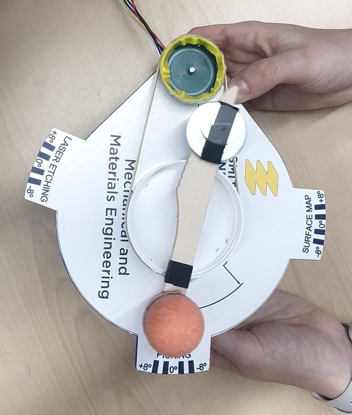
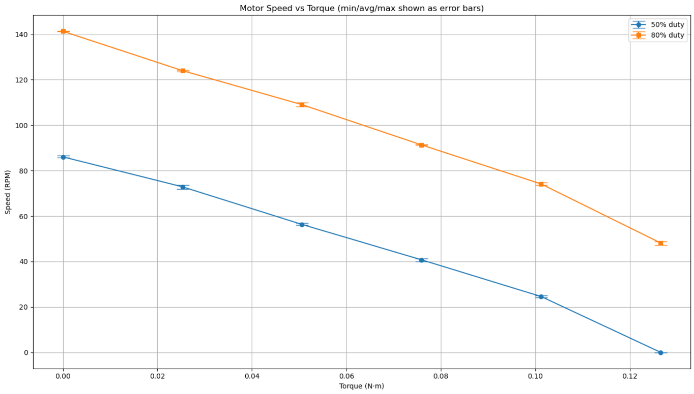

# Femoral Head Indexing Station

**Encoder-based motion control for a belt-driven femoral-head indexing prototype.**

APSC 200 · Queen's University · Winter 2026 · Team 02, Section 203

**Project control software: Shenghan Gao** · [Project portfolio](https://shenghan.cc/projects.html)

## Start here

**[anti_stall_encoder_sign_flip.ino](firmware/anti_stall_encoder_sign_flip/anti_stall_encoder_sign_flip.ino)** is the final version confirmed by Shenghan Gao to have run successfully on the original prototype. It is preserved unchanged, including its tested station commands, encoder sign, and tuning values. Each other sketch is retained as a separate experiment or reference.

## Project

The StrideWorks Prosthetics course scenario asked our team to redesign a rotating manufacturing-cell mechanism that transfers a femoral-head model between picking, laser-etching, and surface-mapping stations.

Our physical prototype used a DC gearmotor, a rubber-band belt between two caps, and a lever carrying the model. Reclaimed materials were used for the transmission and support. The station labels represent manufacturing operations; this prototype does not operate an actual laser or surface scanner.

## My contribution

I independently developed the project-specific control program, including the indexing sequence, belt-ratio conversion, encoder sign correction, PID integration, anti-stall logic, dwell timing, and serial abort/restart handling. I also contributed to the recycled-material transmission, motor testing, and test-data analysis, including Excel organization and Python plotting.

The mechanical prototype and report were team work. Two supplied course starter sketches by **Jason Harris** are retained separately in [`course-examples/`](course-examples/), with their original author notices. See [ATTRIBUTION.md](ATTRIBUTION.md) for individual, team, and reference-code credits.

## Required manufacturing sequence

Clockwise is positive. Station positions are absolute angles measured from picking.

| Step | Required relative move | Nominal station position | Required dwell |
| --- | --- | --- | --- |
| Picking → laser etching | +108° | +108° | 13.5 s |
| Laser etching → surface mapping | −198° | −90° | 9.0 s |
| Surface mapping → picking | +90° | 0° | Cycle ends |

The final saved program uses **+116° and −99°** as its laser and mapping output-angle commands, with a return command of 0°. These are the retained prototype settings, separate from the nominal task requirements. The 13.5 s and 9.0 s dwell values are unchanged. See [controller parameters](docs/controller.md) for the exact conversion and tuning.

## Control approach

- **State machine:** movement and dwell states advance through the station cycle.
- **Encoder feedback:** motor-side rotation is converted to an estimated lever angle using the cap-diameter ratio.
- **PID control:** signed PWM requests respond to motor-angle error.
- **Encoder polarity correction:** `ENCODER_SIGN = -1.0` aligns encoder counts with the chosen motion convention.
- **Anti-stall logic:** a minimum duty floor and periodic progress checks address low-speed friction.
- **Serial control:** `x` aborts; `r` restarts after manual return to the picking station.

The cap diameters are 4.0 cm (driver) and 7.5 cm (driven), giving **1.875 motor degrees per estimated output degree**. The encoder is on the motor side; belt slip and compliance downstream are not directly measured.

## Motor characterization

The supplied plot compares speed–torque behavior at 50% and 80% duty. Its error bars show the reported minimum/average/maximum range. These characterization settings are separate from the final controller's 45% maximum duty. Raw measurement spreadsheets and the plotting script were not included in the supplied archive.

## Demonstration outcome

Shenghan confirmed that the selected controller ran successfully on the prototype. The team report records that the mechanism completed the station motions, met the 13.5 s and 9 s dwell requirements, and kept the model supported. It also reports residual angular deviations of up to approximately 8°, so the ≤2° accuracy goal was not met at every station.

The controller's 1° software tolerance applies to the motor-derived output estimate. It is not a measurement of actual lever accuracy. See [results and source notes](docs/results.md).

## Hardware and setup

| Component | Configuration |
| --- | --- |
| Microcontroller | Raspberry Pi Pico / RP2040, Arduino C++ |
| Motor driver | TB6612FNG |
| Feedback | Quadrature encoder on the motor/gearbox side |
| External libraries | RP2040_PWM, PicoEncoder, ArduPID |
| Serial monitor | 115200 baud; newline required for commands |

Open the `.ino` inside its matching folder and follow [setup and wiring](docs/setup.md). **The program waits for Serial, then starts its first cycle automatically.** Place the lever at picking before connecting the serial monitor with the mechanism ready to run.

## Repository guide

| Folder / file | Contents |
| --- | --- |
| [`firmware/`](firmware/) | User-confirmed successful final controller |
| [`archive/`](archive/) | Six saved control experiments and earlier variants |
| [`diagnostics/`](diagnostics/) | Encoder and motor/encoder-sign diagnostics |
| [`course-examples/`](course-examples/) | Two attributed course starter programs |
| [`docs/code-index.md`](docs/code-index.md) | Guide to all 11 supplied sketches |
| [`docs/controller.md`](docs/controller.md) | Sequence, geometry, and exact saved constants |
| [`docs/implementation-notes.md`](docs/implementation-notes.md) | Static-review findings and operating limits |
| [`UPLOAD_GUIDE.md`](UPLOAD_GUIDE.md) | Chinese GitHub upload instructions |
| [`VALIDATION.md`](VALIDATION.md) | Packaging and verification record |

## Preservation

All 11 `.ino` files are included byte-for-byte. No motion settings or source logic were changed. The supplied photographs/plot and project documents informed the presentation; student-number pages and the full course/team PDFs are omitted from this public upload package.

The files were inspected and packaged, but were not recompiled or tested on hardware during this preparation. Original hardware success is attributed to Shenghan's confirmation. No repository-wide open-source license is assigned to the mixed collection; source notices remain intact.
